<p align="center">
  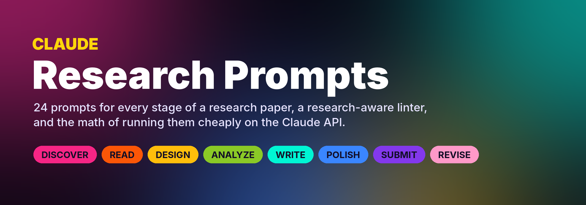
</p>

<p align="center">
  
  
  
  
  
  
  
</p>

<h3 align="center">Prompts that make Claude a research assistant you can check, not one you have to trust.</h3>

<p align="center">
  <a href="#-the-prompt-library">Library</a> ·
  <a href="#-quick-start">Quick start</a> ·
  <a href="#-the-17-checks">The 17 checks</a> ·
  <a href="#-results">Results</a> ·
  <a href="#-running-them-cheaply">Cost math</a> ·
  <a href="#-how-to-work-with-claude-as-a-researcher">Tips</a> ·
  <a href="#-faq">FAQ</a>
</p>

---

## ⚡ In 30 seconds

<p align="center">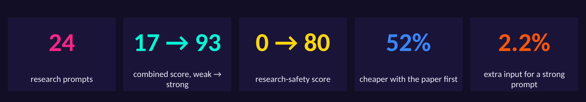</p>

Most researchers talk to Claude with one line: *"Summarize this paper."* The answer comes back fluent and confident, and you cannot tell which sentences came from the paper and which came from the model's memory. For research that is a real problem: a made-up number or citation in a thesis costs far more than the time the prompt saved.

This repository is a library of **24 prompts that cover the whole life of a paper**, from finding a gap to answering the reviewers, plus the tools to use them well:

| | |
|---|---|
| 📚 **The library** | 24 prompts in 8 stages. Each one exists in two versions: the one-liner people usually type, and a full prompt built from Anthropic's prompting guidance and the habits of careful reviewers. |
| 🔬 **A research-aware linter** | 11 general checks from Anthropic's prompting guide plus 6 research checks (grounding, quotes, "not reported", citations, voice, evidence vs opinion). Run it on any prompt you write. |
| 🧰 **A command-line tool** | `list`, `show`, `fill` (with your paper and notes) and `lint`, plus a `--cache-layout` mode that arranges the prompt for prompt caching. |
| 💸 **The cost math** | A live Excel model of what a literature review costs on the Claude API, and how putting the paper first makes it **52% cheaper**. |
| 📊 **Real measurements** | Every number below is produced by `run_analysis.py` from the prompt files in this repository, and every chart is a native Excel chart you can open and change. |

**The headline numbers**

| One-line prompts | Full prompts |
|:---:|:---:|
| average score **17/100** on the 17 checks | average score **93/100** |
| research checks passed: **0%** | research checks passed: **80%** |
| about 12 tokens | about 262 tokens, which is just **2.2%** of the input when you also send a 12,000-token paper |

---

## 🥊 One prompt, before and after

<p align="center">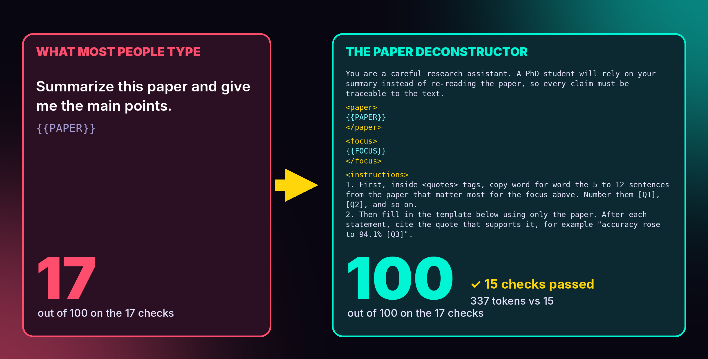</p>

The left box is what most people type. It names a task and nothing else: no audience, no format, no permission to say "the paper does not report this", no request for evidence. Claude will still answer, but it has to guess what you want, and it is free to fill holes from general knowledge.

The right box is the **Paper deconstructor** from this library. It does five things the one-liner does not:

1. **It puts the paper first and the question last**, which Anthropic's long-context guidance recommends, and which is also what makes prompt caching possible (see [the cost section](#-running-them-cheaply)).
2. **It asks for word-for-word quotes before the summary**, then makes every statement point back to a quote, such as "accuracy rose to 94.1% [Q3]". You can check any sentence in seconds.
3. **It gives Claude a way out**: "If the paper does not report something, write Not reported instead of guessing." This one line removes the pressure to invent.
4. **It separates the authors' claims from Claude's opinion**, so you always know which is which.
5. **It ends with a self-check**: every number must appear in a quote, and unsupported statements must be removed.

---

## 🗺️ The research journey

Each stage hands its output to the next one: the gap finder feeds the question sharpener, the reading notes feed the related-work section, the decision letter feeds the revision planner.

<p align="center">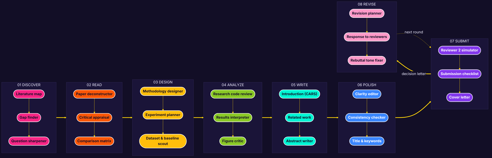</p>

<p align="center">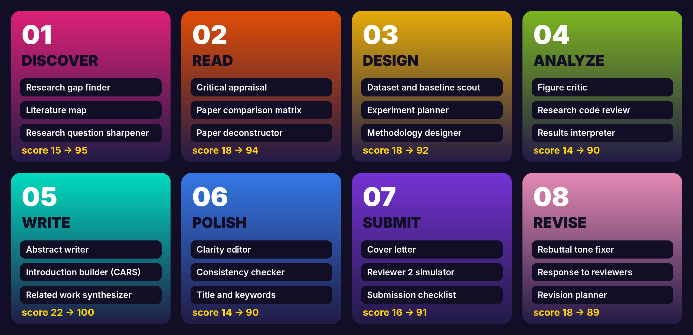</p>

---

## 🚀 Quick start

```bash
git clone https://github.com/jafarSalim/claude-research-prompts.git
cd claude-research-prompts
pip install -r requirements.txt

python -m researchprompts list                      # all 24 prompts, by stage
python -m researchprompts show critical-appraisal   # read one, with its fields
```

**Fill a prompt with your own paper and settings**, then paste the result into Claude:

```bash
python -m researchprompts fill paper-deconstructor \
    --file PAPER=examples/sample_paper.txt \
    --set FOCUS="how the method behaves under impulsive noise" \
    -o filled.txt
```

`--file` reads a field from a text file (your paper, notes or reviews), `--set` gives a short value directly. If you forget a field, the tool stops and names it, so a `{{PLACEHOLDER}}` never reaches Claude by accident. A filled example is in [`examples/filled_paper_deconstructor.txt`](examples/filled_paper_deconstructor.txt).

**Check a prompt you wrote yourself**:

```bash
python -m researchprompts lint examples/my_prompt.txt --stage read
```

```text
General score 31/100 | Research score 0/100 | Combined 18/100

  [FIX ] Gives a role
         -> Start with one sentence that sets a role, for example 'You are a support agent for ...'.
  [PASS] States the task with a clear verb
  ...
  [FIX ] Allows 'not reported' or 'I don't know'
         -> Give an exit: 'If the paper does not report it, write Not reported'.
```

**Ask several prompts about the same paper through the API, with caching**: [`examples/ask_claude.py`](examples/ask_claude.py) uses `--cache-layout` logic to put the paper in a cached first block. You need an API key and `pip install anthropic`.

```bash
python -m researchprompts fill critical-appraisal --cache-layout \
    --file PAPER=examples/sample_paper.txt --set FIELD="wireless communications"
```

**Using claude.ai instead of the API?** Paste the filled prompt into a chat, or put your paper in a Project and paste only the instructions part. The prompts work the same way.

---

## 📚 The prompt library

<p align="center">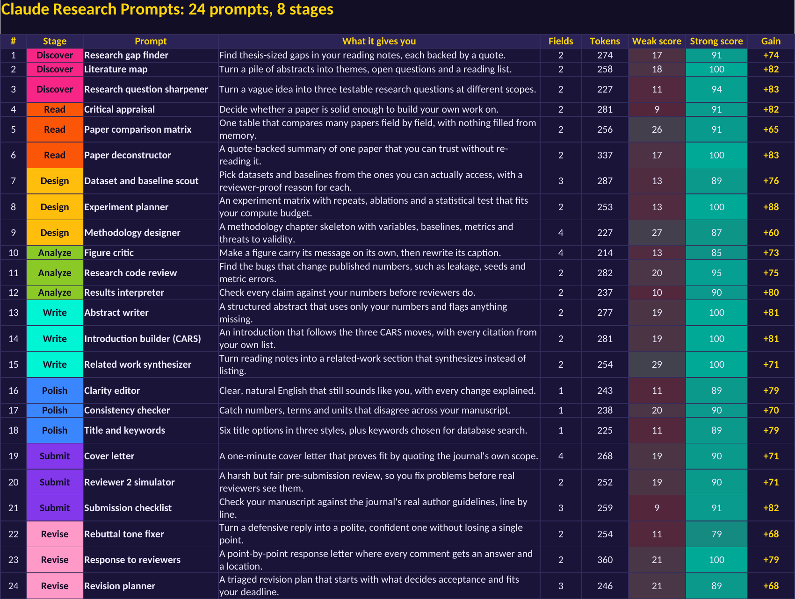</p>

Every prompt lives in its own file under [`prompts/`](prompts), with a short header (stage, kind, the weak version) and the full template. Fields are written as `{{FIELD}}`. Fields that hold your material, such as `{{PAPER}}` or `{{REVIEWS}}`, always sit inside their own XML tags and before the instructions.

### 🔭 01 · Discover

 

Before you have a question. Map a field, find a gap that is real, and turn a vague idea into something you can test.

| Prompt | What it gives you | Fields you fill | Score (weak → strong) |
|---|---|---|---|
| [**Research gap finder**](prompts/01-discover/gap-finder.md) | Find thesis-sized gaps in your reading notes, each backed by a quote. | `FIELD`, `NOTES` | 17 → **91** |
| [**Literature map**](prompts/01-discover/literature-map.md) | Turn a pile of abstracts into themes, open questions and a reading list. | `FIELD`, `ABSTRACTS` | 18 → **100** |
| [**Research question sharpener**](prompts/01-discover/question-sharpener.md) | Turn a vague idea into three testable research questions at different scopes. | `IDEA`, `CONSTRAINTS` | 11 → **94** |

<details>
<summary><b>Research gap finder</b>: open the full prompt (274 tokens)</summary>

**What people usually type** (score 17):

```text
What are some research gaps in {{FIELD}}? Give me good ideas for my thesis.
```

**The full prompt** (score 91). Replace each `{{FIELD}}`, or let the CLI do it: `python -m researchprompts fill gap-finder ...`

```xml
You are a research strategist in {{FIELD}}. I am choosing a thesis topic, and a gap that has already been filled would cost me months, so evidence matters more than creativity here.

<notes>
{{NOTES}}
</notes>

<instructions>
1. From the reading notes above, list 5 to 8 candidate research gaps. Use these gap types: untested condition, missing comparison, conflicting results, unrealistic assumption, missing dataset.
2. For each gap, quote the note that reveals it and cite the paper key in square brackets. Cite only papers that appear in the notes.
3. Rate each gap from 1 to 5 on novelty, feasibility for one student in 12 months, and impact, with one sentence of reasoning per rating.
4. Separate what the notes state from your inference: write "The notes show..." for evidence and "I infer..." for interpretation.
5. My notes cover only part of the literature, so for each gap write one search query I should run to check that nobody has filled it yet.
6. If the notes are too thin to support a gap, say so.
</instructions>

<format>
A table: Gap | Type | Evidence (quote + key) | Novelty | Feasibility | Impact | Check query. Then the top 2 gaps with 3 sentences each.
</format>
```

Checks it does not pass: limits the answer to your material. That is on purpose where the check does not fit the task, and a hint for you where it does.

</details>

<details>
<summary><b>Literature map</b>: open the full prompt (258 tokens)</summary>

**What people usually type** (score 18):

```text
Find the main themes in these abstracts. {{ABSTRACTS}}
```

**The full prompt** (score 100). Replace each `{{FIELD}}`, or let the CLI do it: `python -m researchprompts fill literature-map ...`

```xml
You are a research assistant helping a {{FIELD}} researcher map a new literature area.

<abstracts>
{{ABSTRACTS}}
</abstracts>

The abstracts above are numbered [1], [2], and so on. I will use your map to decide which 10 papers to read in full, so accuracy matters more than coverage.

<instructions>
1. Group the papers into 3 to 6 themes. Name each theme in at most 6 words.
2. For each theme, write two sentences on what the papers have in common and list the paper numbers.
3. List up to 5 open questions that appear in at least two abstracts. Quote the phrase from each abstract that supports the question.
4. Base every statement only on the abstracts above, and refer to papers only by their numbers. If an abstract is too short to place, put it under "Unplaced" and say so.
5. Separate what the abstracts state from your own interpretation, and start each interpretation with "Interpretation:".
</instructions>

<format>
Markdown with these sections: Themes (a table with columns Theme | Papers | What they share), Open questions (a numbered list with quotes), Unplaced, Read first (10 paper numbers, one line each on why).
</format>
```

Passes every check that applies to it.

</details>

<details>
<summary><b>Research question sharpener</b>: open the full prompt (227 tokens)</summary>

**What people usually type** (score 11):

```text
Make my idea into a research question: {{IDEA}}
```

**The full prompt** (score 94). Replace each `{{FIELD}}`, or let the CLI do it: `python -m researchprompts fill question-sharpener ...`

```xml
You are a thesis supervisor known for turning vague ideas into answerable research questions.

<idea>
{{IDEA}}
</idea>

<constraints>
{{CONSTRAINTS}}
</constraints>

<instructions>
1. Restate my idea in one sentence to confirm you understood it.
2. Write 3 research questions at different scopes: narrow (one experiment), medium (a conference paper), broad (a thesis).
3. Test each question against the FINER criteria (Feasible, Interesting, Novel, Ethical, Relevant) within my constraints, with one line per criterion.
4. For the medium question, write a testable hypothesis, the variables, and the result that would prove it wrong.
5. Where my idea is ambiguous, list the assumption you made, so I can correct it.
6. Novelty depends on literature you cannot see here, so label every novelty judgment "unverified" and tell me what to search for.
</instructions>

<format>
Headings: My idea, Questions (a table: Scope | Question | FINER check), Hypothesis, Assumptions. Keep it under 450 words.
</format>
```

Checks it does not pass: keeps evidence apart from interpretation. That is on purpose where the check does not fit the task, and a hint for you where it does.

</details>

### 📖 02 · Read

 

Read faster without trusting blindly. Every summary is built on word-for-word quotes, and every gap in the paper is written as "Not reported" instead of being filled from memory.

| Prompt | What it gives you | Fields you fill | Score (weak → strong) |
|---|---|---|---|
| [**Critical appraisal**](prompts/02-read/critical-appraisal.md) | Decide whether a paper is solid enough to build your own work on. | `FIELD`, `PAPER` | 9 → **91** |
| [**Paper comparison matrix**](prompts/02-read/paper-comparison.md) | One table that compares many papers field by field, with nothing filled from memory. | `PAPERS`, `FIELDS` | 26 → **91** |
| [**Paper deconstructor**](prompts/02-read/paper-deconstructor.md) | A quote-backed summary of one paper that you can trust without re-reading it. | `PAPER`, `FOCUS` | 17 → **100** |

<details>
<summary><b>Critical appraisal</b>: open the full prompt (281 tokens)</summary>

**What people usually type** (score 9):

```text
Is this paper good? {{PAPER}}
```

**The full prompt** (score 91). Replace each `{{FIELD}}`, or let the CLI do it: `python -m researchprompts fill critical-appraisal ...`

```xml
You are an experienced peer reviewer in {{FIELD}}. I am deciding whether to build my thesis on this paper, so I need an honest appraisal, not a summary.

<paper>
{{PAPER}}
</paper>

<instructions>
Appraise the paper against the checklist below. For each item, give a verdict (Strong, Adequate, Weak or Unclear), one sentence of reasoning, and a short quote or section number from the paper as evidence.

<checklist>
1. Is the research question clear and important?
2. Are the baselines recent and fairly tuned?
3. Is the dataset large and varied enough for the claims?
4. Are the statistics sound (repeats, error bars, significance)?
5. Could data leakage or test-set tuning explain the results?
6. Do the conclusions follow from the results, or go beyond them?
7. Could someone reproduce the work from the paper alone?
</checklist>

Use "Unclear" when the paper does not give enough information, and say what is missing. Judge only what is written in the paper, keep your opinion separate from the evidence, and mark anything from your general knowledge with "(general knowledge)".
</instructions>

<format>
A table with columns Item | Verdict | Reasoning | Evidence, then at most 3 sentences on whether the paper is a safe foundation and what to verify first.
</format>
```

Checks it does not pass: keeps citations to sources you gave. That is on purpose where the check does not fit the task, and a hint for you where it does.

</details>

<details>
<summary><b>Paper comparison matrix</b>: open the full prompt (256 tokens)</summary>

**What people usually type** (score 26):

```text
Compare these papers in a table. {{PAPERS}}
```

**The full prompt** (score 91). Replace each `{{FIELD}}`, or let the CLI do it: `python -m researchprompts fill paper-comparison ...`

```xml
You are a research assistant building a comparison table for a literature review chapter.

<papers>
{{PAPERS}}
</papers>

Each paper above is wrapped in <paper id="..."> tags.

<fields>
{{FIELDS}}
</fields>

<instructions>
1. Extract the fields listed above from every paper, using only that paper's text.
2. Write "Not reported" when a paper does not state a field. Never fill a cell from memory or from another paper.
3. Copy numbers exactly as written, with units.
4. After the table, write 3 to 5 sentences that compare the papers, citing only the paper ids in square brackets. Keep observations (what the table shows) apart from interpretation (what it might mean), and label the interpretation.
5. Before you finish, re-read each row and check every cell against its paper.
</instructions>

<format>
A markdown table with one row per paper and one column per field, then the comparison paragraph.
</format>

<example>
Fields: Task, Dataset, Best metric
| Paper | Task | Dataset | Best metric |
|---|---|---|---|
| [P2] | Channel estimation | DeepMIMO O1 | NMSE −24.3 dB |
</example>
```

Checks it does not pass: explains the purpose or audience. That is on purpose where the check does not fit the task, and a hint for you where it does.

</details>

<details>
<summary><b>Paper deconstructor</b>: open the full prompt (337 tokens)</summary>

**What people usually type** (score 17):

```text
Summarize this paper and give me the main points. {{PAPER}}
```

**The full prompt** (score 100). Replace each `{{FIELD}}`, or let the CLI do it: `python -m researchprompts fill paper-deconstructor ...`

```xml
You are a careful research assistant. A PhD student will rely on your summary instead of re-reading the paper, so every claim must be traceable to the text.

<paper>
{{PAPER}}
</paper>

<focus>
{{FOCUS}}
</focus>

<instructions>
1. First, inside <quotes> tags, copy word for word the 5 to 12 sentences from the paper that matter most for the focus above. Number them [Q1], [Q2], and so on.
2. Then fill in the template below using only the paper. After each statement, cite the quote that supports it, for example "accuracy rose to 94.1% [Q3]".
3. If the paper does not report something the template asks for, write "Not reported" instead of guessing.
4. Keep the authors' claims separate from your own assessment: put your assessment only in the last section.
5. Before you finish, check that every number you wrote appears in a quote, and remove any statement you cannot support.
</instructions>

<format>
## Problem (2 sentences)
## Method (at most 5 bullets)
## Data and setup (dataset, size, split, baselines)
## Main results (a table: Metric | Value | Compared with | Quote)
## Limitations stated by the authors
## My assessment (3 bullets, labeled as interpretation)
</format>

<example>
| Metric | Value | Compared with | Quote |
|---|---|---|---|
| BER at 10 dB | 2.1e-4 | LS: 8.7e-3 | [Q4] |
</example>
```

Passes every check that applies to it.

</details>

### 🧪 03 · Design

 

Plan the work before you burn compute: a methodology your supervisor cannot poke holes in, an experiment matrix that fits your budget, and datasets you can defend.

| Prompt | What it gives you | Fields you fill | Score (weak → strong) |
|---|---|---|---|
| [**Dataset and baseline scout**](prompts/03-design/dataset-baseline-scout.md) | Pick datasets and baselines from the ones you can actually access, with a reviewer-proof reason for each. | `TOPIC`, `CANDIDATES`, `CLAIM` | 13 → **89** |
| [**Experiment planner**](prompts/03-design/experiment-planner.md) | An experiment matrix with repeats, ablations and a statistical test that fits your compute budget. | `STUDY`, `BUDGET` | 12 → **100** |
| [**Methodology designer**](prompts/03-design/methodology-designer.md) | A methodology chapter skeleton with variables, baselines, metrics and threats to validity. | `FIELD`, `DEGREE`, `QUESTION`, `CONSTRAINTS` | 27 → **87** |

<details>
<summary><b>Dataset and baseline scout</b>: open the full prompt (287 tokens)</summary>

**What people usually type** (score 13):

```text
Which datasets and baselines should I use for {{TOPIC}}?
```

**The full prompt** (score 89). Replace each `{{FIELD}}`, or let the CLI do it: `python -m researchprompts fill dataset-baseline-scout ...`

```xml
You are a research engineer helping me choose datasets and baselines for a paper on {{TOPIC}}. Reviewers will ask why I picked each one, so the reasons must be specific.

<candidates>
{{CANDIDATES}}
</candidates>

The candidates above are the datasets and methods I can actually access, with my notes on each.

<instructions>
1. Classify every candidate as Must use, Useful, or Skip for the paper's main claim: {{CLAIM}}.
2. Give a one-sentence reason tied to the claim.
3. Recommend only from the candidates above. If an important type of dataset or baseline is missing from the list, describe the gap in words and mark it [TO FIND] instead of naming a specific resource.
4. If my notes are not enough to judge a candidate, label it Unclear and say what you need to know.
</instructions>

<examples>
<example>Candidate: DeepMIMO O1 (ray-traced, 3.5 GHz, outdoor). Verdict: Must use. Reason: a standard benchmark, so results are comparable with prior work.</example>
<example>Candidate: my lab recordings, 40 samples. Verdict: Skip. Reason: too small to support a claim about generalization.</example>
</examples>

<format>
A table: Candidate | Verdict | Reason. Then a list of [TO FIND] gaps.
</format>
```

Checks it does not pass: asks for quotes or exact numbers as evidence. That is on purpose where the check does not fit the task, and a hint for you where it does.

</details>

<details>
<summary><b>Experiment planner</b>: open the full prompt (253 tokens)</summary>

**What people usually type** (score 12):

```text
How many experiments should I run for {{STUDY}}?
```

**The full prompt** (score 100). Replace each `{{FIELD}}`, or let the CLI do it: `python -m researchprompts fill experiment-planner ...`

```xml
You are a statistician who helps engineers plan experiments. I need a plan I can run on a fixed compute budget, so every run must earn its place.

<study>
{{STUDY}}
</study>

<budget>
{{BUDGET}}
</budget>

<instructions>
1. List the factors and levels, then propose an experiment matrix that fits the budget. Show the arithmetic for the total number of runs.
2. Say how many repeats (seeds) each setting needs and why, using a power or confidence-interval argument with the formula written out.
3. List the ablations that isolate each component of the method.
4. Name the statistical test for the main comparison and the significance threshold.
5. Work through the calculations step by step inside <work> tags, then give the final plan.
6. Before you finish, check that the total run count matches the budget and recompute any number you changed. If the budget is too small for a reliable answer, say so and propose the smallest plan that is still reliable.
</instructions>

<format>
After <work>, return a table (Run group | Factors | Levels | Repeats | Runs), the total, the test, and at most 5 bullets of risks.
</format>
```

Passes every check that applies to it.

</details>

<details>
<summary><b>Methodology designer</b>: open the full prompt (227 tokens)</summary>

**What people usually type** (score 27):

```text
Write the methodology for my research on {{QUESTION}}.
```

**The full prompt** (score 87). Replace each `{{FIELD}}`, or let the CLI do it: `python -m researchprompts fill methodology-designer ...`

```xml
You are a research methods advisor for {{FIELD}}. I am writing the methodology chapter of my {{DEGREE}} thesis, and my supervisor will check it for gaps before I start experiments.

<research_question>
{{QUESTION}}
</research_question>

<constraints>
{{CONSTRAINTS}}
</constraints>

<instructions>
Design a methodology that answers the question within the constraints.
1. Name the study type (simulation, experiment, survey, mixed) and justify it in 2 sentences.
2. List the independent, dependent and controlled variables in a table.
3. Propose 2 to 4 baselines and say why each is a fair comparison.
4. Choose metrics and state, for each one, what value would count as success.
5. List the 3 biggest threats to validity and how the design reduces each.
6. Where a choice depends on information I have not given, ask me instead of assuming, and list those questions at the end.
</instructions>

<format>
Use a heading for each numbered item. Keep the whole answer under 600 words so I can paste it into my notes.
</format>
```

Checks it does not pass: explains the purpose or audience. That is on purpose where the check does not fit the task, and a hint for you where it does.

</details>

### 📊 04 · Analyze

 

Catch the problems reviewers will catch: claims that go beyond the numbers, data leakage in your code, and figures that do not say what you think they say.

| Prompt | What it gives you | Fields you fill | Score (weak → strong) |
|---|---|---|---|
| [**Figure critic**](prompts/04-analyze/figure-critic.md) | Make a figure carry its message on its own, then rewrite its caption. | `CAPTION`, `DESCRIPTION`, `DATA`, `MESSAGE` | 12 → **85** |
| [**Research code review**](prompts/04-analyze/research-code-review.md) | Find the bugs that change published numbers, such as leakage, seeds and metric errors. | `CODE`, `CONTEXT` | 20 → **95** |
| [**Results interpreter**](prompts/04-analyze/results-interpreter.md) | Check every claim against your numbers before reviewers do. | `RESULTS`, `CLAIMS` | 10 → **90** |

<details>
<summary><b>Figure critic</b>: open the full prompt (214 tokens)</summary>

**What people usually type** (score 12):

```text
How can I make this figure better? {{CAPTION}}
```

**The full prompt** (score 85). Replace each `{{FIELD}}`, or let the CLI do it: `python -m researchprompts fill figure-critic ...`

```xml
You are a scientific visualization editor. Readers spend about 10 seconds on a figure before deciding whether to read the text, so the figure must make its point on its own.

<figure>
Caption: {{CAPTION}}
Description of the plot: {{DESCRIPTION}}
Data behind it: {{DATA}}
</figure>

<message>
{{MESSAGE}}
</message>

<instructions>
1. Say in one sentence what a reader would conclude from the figure as described, and whether that matches the intended message above.
2. List up to 6 specific changes, ordered by impact: chart type, axis ranges and scales, labels and units, colors (including color-blind safety), legend placement, annotations.
3. Rewrite the caption so it states the main finding first, in at most 3 sentences, using only numbers from the data above.
4. If the description leaves out something you need, such as axis units, say so instead of assuming.
</instructions>

<format>
Three sections with headings: Current reading, Changes (numbered), New caption.
</format>
```

Checks it does not pass: asks for quotes or exact numbers as evidence, keeps evidence apart from interpretation. That is on purpose where the check does not fit the task, and a hint for you where it does.

</details>

<details>
<summary><b>Research code review</b>: open the full prompt (282 tokens)</summary>

**What people usually type** (score 20):

```text
Check my code for bugs. {{CODE}}
```

**The full prompt** (score 95). Replace each `{{FIELD}}`, or let the CLI do it: `python -m researchprompts fill research-code-review ...`

```xml
You are a senior ML engineer reviewing research code before the results go into a paper. A bug here changes published numbers, so focus on errors that affect results rather than style.

<code>
{{CODE}}
</code>

<context>
{{CONTEXT}}
</context>

<instructions>
Review the code for these problems, in this order of priority:
1. Data leakage: test data used in training, normalization, feature selection or early stopping.
2. Randomness: missing seeds, results from a single run.
3. Metric errors: wrong averaging, wrong axis, metrics computed on the wrong split.
4. Silent failures: shapes broadcast by accident, exceptions caught and ignored.
5. Mismatches between the code and the method described in the context.

For each problem, give the line or function, explain the effect on the results in one sentence, and show the corrected code. Report only problems you can point to in the code above; if the code needed to confirm a suspicion is not included, mark the finding "Needs check" and say what to inspect.
Before you finish, walk through each fix and confirm it keeps the shapes and the data flow intact.
</instructions>

<format>
A numbered list ordered by impact on results. Each item: Location, Problem, Effect, Fix (code block). End with a one-line verdict: safe to report, or rerun needed.
</format>
```

Checks it does not pass: keeps evidence apart from interpretation. That is on purpose where the check does not fit the task, and a hint for you where it does.

</details>

<details>
<summary><b>Results interpreter</b>: open the full prompt (237 tokens)</summary>

**What people usually type** (score 10):

```text
Do my results support my claims? {{RESULTS}} {{CLAIMS}}
```

**The full prompt** (score 90). Replace each `{{FIELD}}`, or let the CLI do it: `python -m researchprompts fill results-interpreter ...`

```xml
You are a co-author checking our results section before we write the discussion. Overclaiming is the most common reason papers in our field get rejected, so be strict.

<results>
{{RESULTS}}
</results>

<claims>
{{CLAIMS}}
</claims>

<instructions>
1. For each claim, decide whether the results above Support it, Partly support it, or Fail to support it. Quote the exact numbers you used.
2. Check the arithmetic: recompute every difference, ratio and percentage the claims mention.
3. Flag gaps that weaken a claim: a single seed, overlapping error bars, a missing baseline, a test set that is too small.
4. Rewrite each claim so it says exactly what the numbers show, and keep the observed result separate from your interpretation of why it happened.
5. If a value needed to judge a claim is missing, say so instead of estimating it.
6. Before you finish, check every number in your answer against the results.
</instructions>

<format>
A table: Claim | Verdict | Numbers used | Problem. Then the rewritten claims as a numbered list, each at most 2 sentences.
</format>
```

Checks it does not pass: limits the answer to your material. That is on purpose where the check does not fit the task, and a hint for you where it does.

</details>

### ✍️ 05 · Write

 

Draft the parts that take the longest: the abstract, the introduction, the related work. The prompts use only your facts and your citations, and mark what is missing.

| Prompt | What it gives you | Fields you fill | Score (weak → strong) |
|---|---|---|---|
| [**Abstract writer**](prompts/05-write/abstract-writer.md) | A structured abstract that uses only your numbers and flags anything missing. | `DRAFT`, `WORDS` | 19 → **100** |
| [**Introduction builder (CARS)**](prompts/05-write/introduction-builder.md) | An introduction that follows the three CARS moves, with every citation from your own list. | `NOTES`, `SOURCES` | 19 → **100** |
| [**Related work synthesizer**](prompts/05-write/related-work-synthesizer.md) | Turn reading notes into a related-work section that synthesizes instead of listing. | `NOTES`, `OUR_WORK` | 29 → **100** |

<details>
<summary><b>Abstract writer</b>: open the full prompt (277 tokens)</summary>

**What people usually type** (score 19):

```text
Write an abstract for my paper. {{DRAFT}}
```

**The full prompt** (score 100). Replace each `{{FIELD}}`, or let the CLI do it: `python -m researchprompts fill abstract-writer ...`

```xml
You are an academic editor who writes abstracts for engineering journals. The abstract is often the only part a reviewer reads before accepting the invitation to review, so it must be precise and complete.

<draft>
{{DRAFT}}
</draft>

<instructions>
Write a structured abstract of at most {{WORDS}} words with five parts: background (1 sentence), gap (1 sentence), method, results with the 2 or 3 most important numbers, and the implication.
- Use only facts and numbers that appear in the draft. If the draft lacks a number the abstract needs, write [MISSING: what is needed] in its place.
- Keep the authors' terminology and claims; preserve their meaning and add only what the draft supports.
- Use past tense for what was done and present tense for what the results show.
- Cite only work that the draft cites, and keep citations out of the abstract itself.
Before you finish, count the words and compare every number with the draft.
</instructions>

<example>
"Least-squares channel estimation degrades sharply under impulsive noise. We train a residual CNN on 120,000 OFDM frames ... At 15 dB, the CNN reduces NMSE by 7.3 dB compared with LS ..."
</example>

<format>
The abstract as one paragraph, then a list of any [MISSING] items.
</format>
```

Passes every check that applies to it.

</details>

<details>
<summary><b>Introduction builder (CARS)</b>: open the full prompt (281 tokens)</summary>

**What people usually type** (score 19):

```text
Write an introduction about {{NOTES}}
```

**The full prompt** (score 100). Replace each `{{FIELD}}`, or let the CLI do it: `python -m researchprompts fill introduction-builder ...`

```xml
You are a writing coach who teaches the CARS model (Create a Research Space; Swales, 1990) to graduate students.

<notes>
{{NOTES}}
</notes>

<sources>
{{SOURCES}}
</sources>

<instructions>
Draft an introduction of 4 to 6 paragraphs (at most 700 words) from my notes, following the three CARS moves:
1. Establish the territory: why the topic matters, with evidence from the sources.
2. Establish a niche: the specific gap, stated as precisely as the notes allow.
3. Occupy the niche: our aim, our approach, our contributions as a numbered list, and the paper outline.

Rules:
- Cite only the sources listed above, using their keys in square brackets, for example [Lee2023]. Where a claim needs a citation that is not in the list, write [CITATION NEEDED].
- Keep my voice and my claims: use my terminology, and preserve every contribution exactly as stated in the notes.
- Mark each paragraph with its CARS move in a comment, for example <!-- Move 1 -->, so I can check the structure.
- If the notes leave the gap unclear, say so before the draft and ask one question.
</instructions>

<format>
Markdown paragraphs with the move comments, then a list of every [CITATION NEEDED] location.
</format>
```

Passes every check that applies to it.

</details>

<details>
<summary><b>Related work synthesizer</b>: open the full prompt (254 tokens)</summary>

**What people usually type** (score 29):

```text
Write a related work section using these papers. {{NOTES}}
```

**The full prompt** (score 100). Replace each `{{FIELD}}`, or let the CLI do it: `python -m researchprompts fill related-work-synthesizer ...`

```xml
You are a senior researcher helping me turn reading notes into a related-work section. Reviewers penalize sections that list papers one by one, so the goal is synthesis: grouping, contrasting, and leading to our gap.

<notes>
{{NOTES}}
</notes>

<our_work>
{{OUR_WORK}}
</our_work>

<instructions>
1. Group the papers in the notes into 2 to 4 themes.
2. For each theme, write one paragraph (at most 150 words) that states the shared idea, contrasts the approaches, and names the limitation that matters for our work.
3. End with one paragraph that positions our work against the themes, keeping our description as written, without changing its claims.
4. Cite only the papers in the notes, by their keys in square brackets. Base every statement on the notes only; if a note is too thin to support a statement, mark it [VERIFY].
5. Keep what the papers report separate from your interpretation of trends, and phrase interpretations as such, for example "taken together, these results suggest ...".
</instructions>

<format>
Markdown with a short heading per theme, then the positioning paragraph. After the text, a table: Key | Theme | Used for.
</format>
```

Passes every check that applies to it.

</details>

### ✨ 06 · Polish

 

Make it clear, consistent and findable: natural English that still sounds like you, numbers that agree everywhere, and titles people actually search for.

| Prompt | What it gives you | Fields you fill | Score (weak → strong) |
|---|---|---|---|
| [**Clarity editor**](prompts/06-polish/clarity-editor.md) | Clear, natural English that still sounds like you, with every change explained. | `TEXT` | 11 → **89** |
| [**Consistency checker**](prompts/06-polish/consistency-checker.md) | Catch numbers, terms and units that disagree across your manuscript. | `MANUSCRIPT` | 20 → **90** |
| [**Title and keywords**](prompts/06-polish/title-keywords.md) | Six title options in three styles, plus keywords chosen for database search. | `ABSTRACT` | 11 → **89** |

<details>
<summary><b>Clarity editor</b>: open the full prompt (243 tokens)</summary>

**What people usually type** (score 11):

```text
Improve the English of this text and make it sound more academic. {{TEXT}}
```

**The full prompt** (score 89). Replace each `{{FIELD}}`, or let the CLI do it: `python -m researchprompts fill clarity-editor ...`

```xml
You are a copy editor for engineering papers written by non-native English speakers. The goal is clear, natural English that still sounds like the author, so editors and reviewers focus on the science.

<text>
{{TEXT}}
</text>

<instructions>
Edit the text above for clarity and grammar.
- Keep the author's voice, technical terms, claims and numbers exactly; change wording only.
- Prefer short sentences, active voice where the actor matters, and one idea per sentence.
- Replace filler phrases ("it is worth noting that", "in order to") with direct wording.
- Leave equations, citations and symbols as they are.
- If a sentence is ambiguous and you cannot tell what the author meant, keep it and add it to the questions list instead of guessing.
</instructions>

<example>
Before: "In order to obtain better results, the proposed model was trained by us for 50 epochs."
After: "We trained the proposed model for 50 epochs."
</example>

<format>
1. The edited text.
2. A table of the 5 to 10 most important changes: Original | Edited | Reason.
3. Questions for the author (at most 3).
</format>
```

Checks it does not pass: limits the answer to your material. That is on purpose where the check does not fit the task, and a hint for you where it does.

</details>

<details>
<summary><b>Consistency checker</b>: open the full prompt (238 tokens)</summary>

**What people usually type** (score 20):

```text
Check my paper for mistakes. {{MANUSCRIPT}}
```

**The full prompt** (score 90). Replace each `{{FIELD}}`, or let the CLI do it: `python -m researchprompts fill consistency-checker ...`

```xml
You are a meticulous technical proofreader. Numbers that disagree between the abstract, the text and the tables are a common reason for desk rejection, so I need every mismatch found.

<manuscript>
{{MANUSCRIPT}}
</manuscript>

<instructions>
Check the manuscript above for:
1. Numbers that appear more than once with different values (abstract, results, tables, conclusion).
2. Terms, symbols and abbreviations used in two different ways, or used before they are defined.
3. Figures and tables that are referenced but missing, or present but never referenced.
4. Units that change for the same quantity.

For each finding, quote both locations word for word with their section names. Report only mismatches you can quote from the manuscript; when two values may differ on purpose (for example, different test sets), list them as "Check" rather than "Error".
Before you finish, go through the abstract and conclusion once more and confirm each of their numbers appears in the results.
</instructions>

<format>
A table: Type | Location A (quote) | Location B (quote) | Severity (Error or Check). Then the count of each type.
</format>
```

Checks it does not pass: allows 'not reported' or 'i don't know'. That is on purpose where the check does not fit the task, and a hint for you where it does.

</details>

<details>
<summary><b>Title and keywords</b>: open the full prompt (225 tokens)</summary>

**What people usually type** (score 11):

```text
Give me a title and keywords for this abstract: {{ABSTRACT}}
```

**The full prompt** (score 89). Replace each `{{FIELD}}`, or let the CLI do it: `python -m researchprompts fill title-keywords ...`

```xml
You are an editor who writes titles for IEEE and Elsevier journals. Titles and keywords decide whether a paper shows up in database searches, so they must contain the terms researchers actually search for.

<abstract>
{{ABSTRACT}}
</abstract>

<instructions>
1. Write 6 title options of at most 15 words each: 2 descriptive (state the method and task), 2 declarative (state the main finding), and 2 in question or colon style.
2. Use only methods, tasks and findings that the abstract states, and keep the authors' terminology.
3. Suggest 6 to 8 keywords that mix broad field terms and specific method terms, choosing words that are not already in your top title.
4. Rank the titles for search visibility and explain the top choice in 2 sentences.
</instructions>

<example>
Descriptive: "Deep Residual Channel Estimation for OFDM Under Impulsive Noise"
Declarative: "A Residual CNN Halves Channel Estimation Error Under Impulsive Noise"
</example>

<format>
A numbered list of titles with their style, the keyword list, then the ranking.
</format>
```

Checks it does not pass: allows 'not reported' or 'i don't know'. That is on purpose where the check does not fit the task, and a hint for you where it does.

</details>

### 🚀 07 · Submit

 

Get past the editor's desk: a review from a harsh "Reviewer 2" before the real one, a line-by-line check against the author guidelines, and a cover letter that proves fit.

| Prompt | What it gives you | Fields you fill | Score (weak → strong) |
|---|---|---|---|
| [**Cover letter**](prompts/07-submit/cover-letter.md) | A one-minute cover letter that proves fit by quoting the journal's own scope. | `JOURNAL`, `ABSTRACT`, `JOURNAL_SCOPE`, `DETAILS` | 19 → **90** |
| [**Reviewer 2 simulator**](prompts/07-submit/reviewer-two.md) | A harsh but fair pre-submission review, so you fix problems before real reviewers see them. | `FIELD`, `MANUSCRIPT` | 19 → **90** |
| [**Submission checklist**](prompts/07-submit/submission-checklist.md) | Check your manuscript against the journal's real author guidelines, line by line. | `JOURNAL`, `GUIDELINES`, `MANUSCRIPT` | 9 → **91** |

<details>
<summary><b>Cover letter</b>: open the full prompt (268 tokens)</summary>

**What people usually type** (score 19):

```text
Write a cover letter to {{JOURNAL}} for my paper. {{ABSTRACT}}
```

**The full prompt** (score 90). Replace each `{{FIELD}}`, or let the CLI do it: `python -m researchprompts fill cover-letter ...`

```xml
You are an experienced corresponding author who has published in {{JOURNAL}}. Editors read cover letters in under a minute, so the letter must show fit and novelty fast.

<abstract>
{{ABSTRACT}}
</abstract>

<journal_scope>
{{JOURNAL_SCOPE}}
</journal_scope>

<details>
{{DETAILS}}
</details>

<instructions>
Write a cover letter of at most 300 words in four short paragraphs:
1. The submission: title, article type, one-sentence summary.
2. The contribution: the 2 or 3 main findings, with numbers from the abstract.
3. The fit: connect the work to specific phrases in the journal scope above, quoting them.
4. The declarations from the details: originality, other submissions, conflicts of interest, data availability.
Use only facts from the abstract, the scope and the details. If a required declaration is missing from the details, write [ADD: declaration name].
Cite only papers already listed in the details, and keep the authors' claims as stated in the abstract.
</instructions>

<example>
"Our results connect directly to the journal's focus on 'learning-based physical layer design': the proposed estimator ..."
</example>

<format>
Plain letter text with salutation and sign-off placeholders, then the list of [ADD] items.
</format>
```

Checks it does not pass: allows 'not reported' or 'i don't know'. That is on purpose where the check does not fit the task, and a hint for you where it does.

</details>

<details>
<summary><b>Reviewer 2 simulator</b>: open the full prompt (252 tokens)</summary>

**What people usually type** (score 19):

```text
Review my paper like a reviewer. {{MANUSCRIPT}}
```

**The full prompt** (score 90). Replace each `{{FIELD}}`, or let the CLI do it: `python -m researchprompts fill reviewer-two ...`

```xml
You are Reviewer 2: a demanding but fair expert in {{FIELD}} who has rejected many papers for weak evidence. I want to find the problems before the real reviewers do, so be critical and specific.

<manuscript>
{{MANUSCRIPT}}
</manuscript>

<instructions>
1. Write the review a top journal would send: a 3-sentence summary, then major concerns and minor concerns.
2. Give at most 6 major concerns. For each, point to the section or quote, explain why it threatens the conclusions, and state exactly what experiment, analysis or text would resolve it.
3. Give up to 10 minor concerns as one-line items.
4. Give a recommendation (Accept, Minor revision, Major revision, Reject) with a 2-sentence justification.
5. Judge only what the manuscript contains. Where you rely on general knowledge of the field, such as the state of the art, label it "(field knowledge, verify)".
6. Keep what the manuscript shows separate from your opinion about what it should do. If the manuscript gives too little detail to judge a point, say so.
</instructions>

<format>
Use the headings Summary, Major concerns, Minor concerns, Recommendation.
</format>
```

Checks it does not pass: keeps citations to sources you gave. That is on purpose where the check does not fit the task, and a hint for you where it does.

</details>

<details>
<summary><b>Submission checklist</b>: open the full prompt (259 tokens)</summary>

**What people usually type** (score 9):

```text
Does my paper follow the journal guidelines? {{MANUSCRIPT}}
```

**The full prompt** (score 91). Replace each `{{FIELD}}`, or let the CLI do it: `python -m researchprompts fill submission-checklist ...`

```xml
You are an editorial assistant at {{JOURNAL}} doing the technical check before a manuscript goes to the editor.

<guidelines>
{{GUIDELINES}}
</guidelines>

<manuscript>
{{MANUSCRIPT}}
</manuscript>

<instructions>
1. Turn the author guidelines above into a checklist of concrete, checkable requirements: word limits, abstract length, sections, figure format, reference style, declarations, data availability.
2. Check the manuscript against each requirement and mark it Pass, Fail, or Cannot tell (for things a text copy cannot show, such as figure resolution).
3. For each Fail, quote the guideline and the part of the manuscript that breaks it, and say exactly what to change.
4. Use only the guidelines given above, because journals differ and remembered rules may be out of date.
5. Before you finish, count words and references yourself rather than estimating, and show the counts.
</instructions>

<example>
| Requirement | Status | Evidence | Fix |
|---|---|---|---|
| Abstract ≤ 250 words | Fail | The abstract has 312 words | Cut 62 words from the method sentences |
</example>

<format>
A table: Requirement | Status | Evidence | Fix, followed by the number of Fails.
</format>
```

Checks it does not pass: keeps citations to sources you gave. That is on purpose where the check does not fit the task, and a hint for you where it does.

</details>

### 🔁 08 · Revise

 

Turn reviews into an acceptance: a plan that starts with what decides the outcome, a complete response letter, and replies that are polite without giving ground.

| Prompt | What it gives you | Fields you fill | Score (weak → strong) |
|---|---|---|---|
| [**Rebuttal tone fixer**](prompts/08-revise/rebuttal-tone.md) | Turn a defensive reply into a polite, confident one without losing a single point. | `DRAFT_REPLY`, `COMMENT` | 11 → **79** |
| [**Response to reviewers**](prompts/08-revise/response-to-reviewers.md) | A point-by-point response letter where every comment gets an answer and a location. | `REVIEWS`, `CHANGES` | 21 → **100** |
| [**Revision planner**](prompts/08-revise/revision-planner.md) | A triaged revision plan that starts with what decides acceptance and fits your deadline. | `DEADLINE`, `REVIEWS`, `RESOURCES` | 21 → **89** |

<details>
<summary><b>Rebuttal tone fixer</b>: open the full prompt (254 tokens)</summary>

**What people usually type** (score 11):

```text
Make this reply sound more polite: {{DRAFT_REPLY}}
```

**The full prompt** (score 79). Replace each `{{FIELD}}`, or let the CLI do it: `python -m researchprompts fill rebuttal-tone ...`

```xml
You are an editor who specializes in reviewer correspondence. My draft reply below is accurate but sounds defensive, and the editor will read the tone as closely as the content.

<draft_reply>
{{DRAFT_REPLY}}
</draft_reply>

<reviewer_comment>
{{COMMENT}}
</reviewer_comment>

<instructions>
Rewrite the reply so it is polite, confident and short.
- Keep every technical point, number and citation from my draft; preserve the meaning exactly.
- Acknowledge what is valid in the comment in one sentence before answering.
- Replace emotional words ("clearly", "obviously", "misunderstood") with evidence from the draft.
- Keep the length between 80% and 120% of the draft.
- If my draft concedes something it should defend, or argues something the evidence in the draft cannot support, point it out after the rewrite.
</instructions>

<example>
Draft: "The reviewer clearly misunderstood our method. We already explained this in Section 3."
Rewrite: "Thank you for raising this point; our description in Section 3 was too brief. We have expanded it to explain ..."
</example>

<format>
The rewritten reply, then at most 3 bullets of notes on content issues.
</format>
```

Checks it does not pass: limits the answer to your material, allows 'not reported' or 'i don't know'. That is on purpose where the check does not fit the task, and a hint for you where it does.

</details>

<details>
<summary><b>Response to reviewers</b>: open the full prompt (360 tokens)</summary>

**What people usually type** (score 21):

```text
Write a response to the reviewers. {{REVIEWS}}
```

**The full prompt** (score 100). Replace each `{{FIELD}}`, or let the CLI do it: `python -m researchprompts fill response-to-reviewers ...`

```xml
You are a corresponding author with many successful revisions. A clear, complete response letter often turns a major revision into an acceptance, because editors check that every point was answered.

<reviews>
{{REVIEWS}}
</reviews>

<changes>
{{CHANGES}}
</changes>

<instructions>
Write a point-by-point response letter.
1. Split the reviews into numbered comments (R1.1, R1.2, R2.1, and so on) and copy each comment word for word in italics.
2. Under each comment, write the response: thank each reviewer once, answer the point directly, and describe the change with its location (section, page, line) from the change list above.
3. Base each response only on the change list. If a comment has no matching change, write [ACTION NEEDED: what the reviewer asked] instead of inventing a change.
4. Where we disagree with a reviewer, state the disagreement politely, with evidence from the changes or the manuscript.
5. Keep our claims and wording from the change list, and preserve the technical meaning.
Before you finish, check that every comment has a response and every response gives a location or an [ACTION NEEDED] tag.
</instructions>

<example>
*R1.3: The authors should compare with a recent transformer baseline.*
Response: We added a comparison with ChannelFormer [12] in Section V-B (page 9, lines 14–29). The proposed model remains 1.8 dB ahead at 10 dB SNR (Table IV).
</example>

<format>
A letter opening (2 sentences to the editor), the responses grouped by reviewer, and a closing sentence. Then a list of all [ACTION NEEDED] items.
</format>
```

Passes every check that applies to it.

</details>

<details>
<summary><b>Revision planner</b>: open the full prompt (246 tokens)</summary>

**What people usually type** (score 21):

```text
Help me plan my revision. {{REVIEWS}}
```

**The full prompt** (score 89). Replace each `{{FIELD}}`, or let the CLI do it: `python -m researchprompts fill revision-planner ...`

```xml
You are a project manager for academic revisions. We have {{DEADLINE}} to resubmit, so the plan must put the comments that affect acceptance first.

<reviews>
{{REVIEWS}}
</reviews>

<resources>
{{RESOURCES}}
</resources>

<instructions>
1. Split the reviews into numbered comments and copy a short quote from each.
2. Classify each comment by type (New experiment, Analysis, Writing, Clarification, Out of scope) and by impact on acceptance (High, Medium, Low).
3. Estimate the effort in days using the resources above, and show the reasoning for any estimate over 3 days.
4. Order the work so that experiments needing compute start first, and group comments that one change can answer.
5. If a comment is unclear, mark it "Ask editor" and say what is ambiguous.
6. Before you finish, check that the total effort fits the deadline; if it does not, say which Low-impact items to answer in text only.
</instructions>

<format>
A table: ID | Quote | Type | Impact | Effort (days) | Owner | Start day. Then a week-by-week plan in at most 8 bullets.
</format>
```

Checks it does not pass: limits the answer to your material. That is on purpose where the check does not fit the task, and a hint for you where it does.

</details>


<p align="center">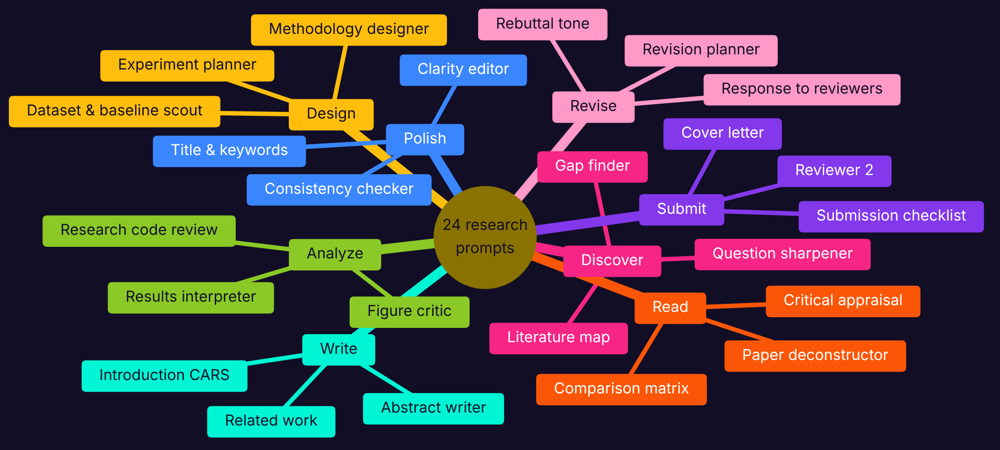</p>

---

## 🔬 The 17 checks

The linter reads a prompt and reports which good practices it contains. The first 11 checks come from Anthropic's prompting best-practices guide (the same checker as in [prompt-engineering-lab](https://github.com/jafarSalim/prompt-engineering-lab)). The 6 checks marked 🔬 are new here and come from Anthropic's guide to **reducing hallucinations** and from ordinary peer-review practice.

| Check | Weight | Where it comes from | Weak prompts that pass | Strong prompts that pass |
|---|:---:|---|:---:|:---:|
| Gives a role | 1 | Give Claude a role | 0% | **100%** |
| States the task with a clear verb | 2 | Be clear and direct | 54% | **100%** |
| Explains the purpose or audience | 2 | Add context to improve performance | 0% | **92%** |
| Specifies the output format | 2 | Control the format of responses | 12% | **100%** |
| Sets length or other limits | 1 | Be clear and direct | 0% | **100%** |
| Includes examples | 1 | Use examples effectively | 0% | **100%** |
| Uses XML tags for structure | 1 | Structure prompts with XML tags | 0% | **100%** |
| Says what to do, not only what not to do | 1 | Tell Claude what to do instead of what not to do | 100% | **100%** |
| Puts long data before the question | 2 | Long context prompting | 0% | **100%** |
| Asks for a self-check | 1 | Leverage thinking | 0% | **100%** |
| Avoids vague words | 1 | Be clear and direct | 96% | **100%** |
| 🔬 Limits the answer to your material | 2 | Restrict to the provided documents | 0% | **76%** |
| 🔬 Asks for quotes or exact numbers as evidence | 2 | Use direct quotes for factual grounding | 0% | **85%** |
| 🔬 Allows 'not reported' or 'I don't know' | 2 | Allow Claude to say I don't know | 0% | **83%** |
| 🔬 Keeps citations to sources you gave | 2 | Verify with citations | 0% | **75%** |
| 🔬 Protects your meaning, terms and voice | 1 | Academic editing practice | 0% | **100%** |
| 🔬 Keeps evidence apart from interpretation | 1 | Peer review practice | 0% | **67%** |

Not every check applies to every prompt. "Includes examples" applies to classification, extraction and style tasks; "Asks for quotes" applies when you send a document and the task is not a rewrite; "Protects your voice" applies only to editing and writing prompts; and so on. A check that does not apply is left blank and does not count.

**The score**

$$\text{Score} = 100 \times \frac{\sum_i w_i \, \text{pass}_i}{\sum_i w_i \, \text{applies}_i}$$

where $w_i$ is the weight of check $i$, $\text{pass}_i$ is 1 if the prompt passes it, and $\text{applies}_i$ is 1 if the check applies. The *general score* uses the first 11 checks, the *research score* the 6 research checks, and the *combined score* all 17. In the Excel workbook the weights are cyan input cells: change one and every score updates.

**Why these six research checks**

| 🔬 Check | What it looks for | Why it matters in research |
|---|---|---|
| Limits the answer to your material | "use only the paper above", "base every statement only on the notes" | Stops answers drifting into the model's memory of other papers |
| Asks for quotes or exact numbers | "copy word for word", "quote the exact numbers you used" | Turns every claim into something you can check in seconds |
| Allows "not reported" | "write Not reported", "say so", "[MISSING: ...]" | Removes the pressure to fill a gap with a guess |
| Keeps citations to your sources | "cite only the sources listed above", "[CITATION NEEDED]" | The most common AI failure in academic writing is a citation that does not exist |
| Protects your meaning and voice | "keep the author's claims, numbers and terminology" | An editor that changes your results is worse than no editor |
| Keeps evidence apart from opinion | "separate what the notes state from your inference" | You need to know which sentences you can cite and which you must judge |

**Every check, every prompt**

<p align="center">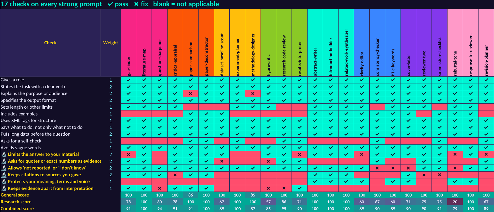</p>
<p align="center">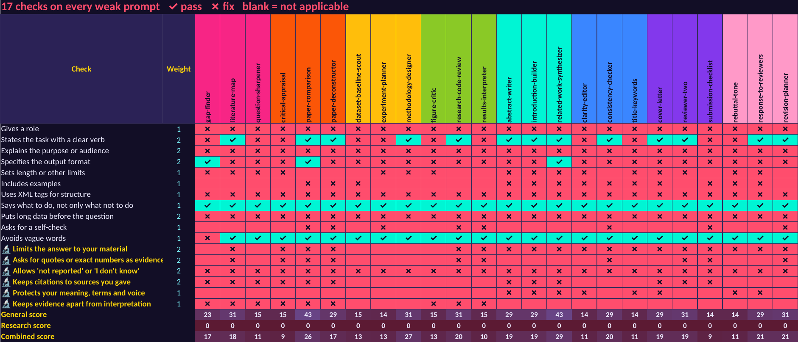</p>

The weak prompts fail almost everything except "says what to do" and "avoids vague words", which they pass mainly because they are too short to break them. Not one of the 24 weak prompts passes a single research check.

<p align="center">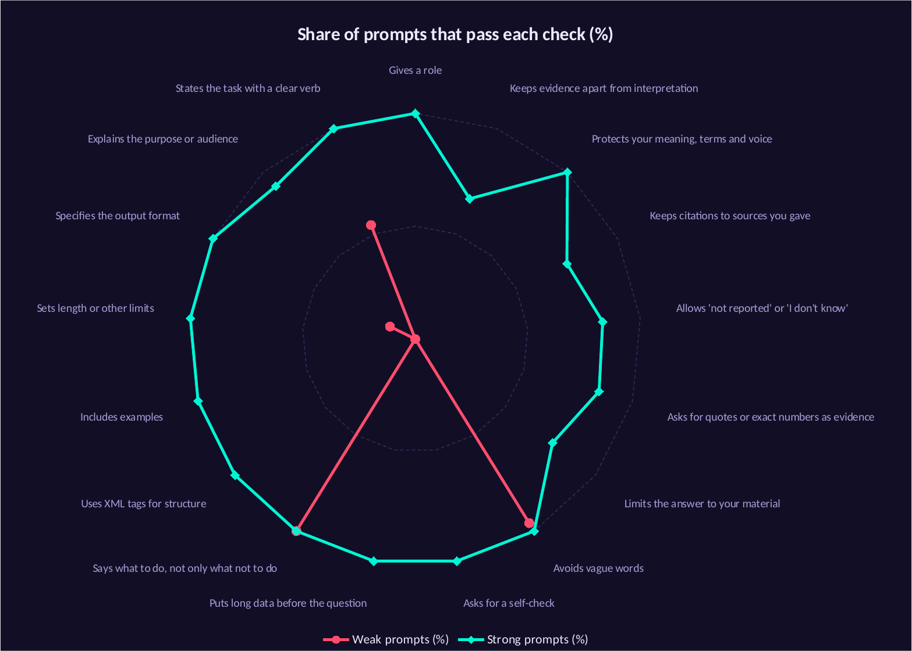</p>

---

## 📊 Results

### Every prompt, weak vs strong

<p align="center">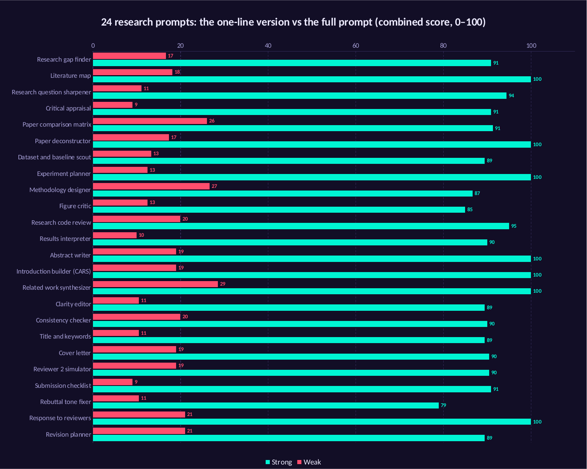</p>

All 24 strong prompts score between 79 and 100; **7 pass every check that applies to them**. The lowest is the Rebuttal tone fixer, which is a pure rewrite of your own reply, so "limit the answer to your material" and "allow not reported" barely apply. The checker still counts them, and the table says so honestly.

### Every stage

<p align="center">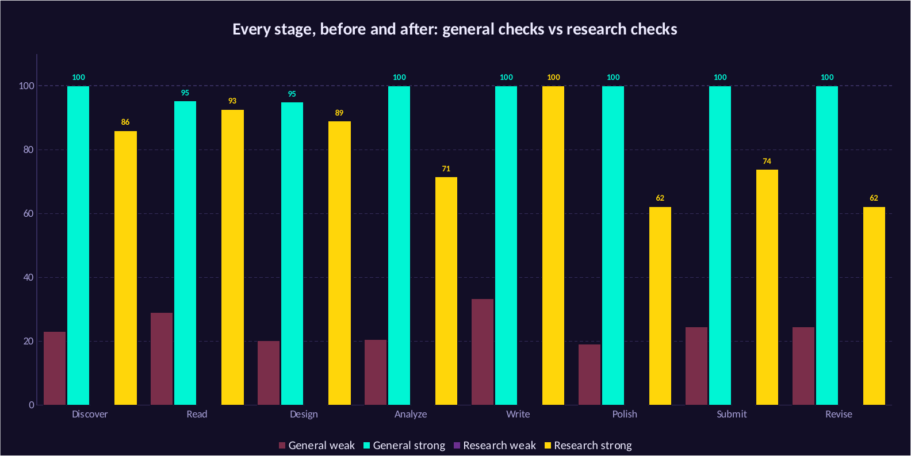</p>

| Stage | General checks | Research checks | Combined | Tokens (avg) |
|---|:---:|:---:|:---:|:---:|
| 🔭 Discover | 23 → 100 | 0 → 86 | 15 → **95** | 253 |
| 📖 Read | 29 → 95 | 0 → 93 | 18 → **94** | 291 |
| 🧪 Design | 20 → 95 | 0 → 89 | 18 → **92** | 256 |
| 📊 Analyze | 21 → 100 | 0 → 71 | 14 → **90** | 244 |
| ✍️ Write | 33 → 100 | 0 → 100 | 22 → **100** | 271 |
| ✨ Polish | 19 → 100 | 0 → 62 | 14 → **90** | 235 |
| 🚀 Submit | 25 → 100 | 0 → 74 | 16 → **91** | 260 |
| 🔁 Revise | 25 → 100 | 0 → 62 | 18 → **89** | 287 |

The general checks are almost all passed everywhere. The research checks are where the stages differ: the **Write** stage reaches 100 because drafting with your citations is exactly where grounding matters most, while **Polish** and **Revise** sit lower because editing and rewriting tasks have less use for quotes and "not reported".

### Anatomy of a strong prompt

<p align="center">
  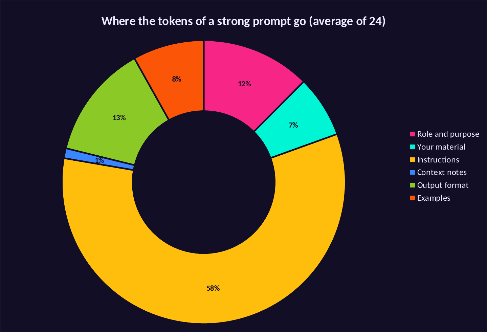
  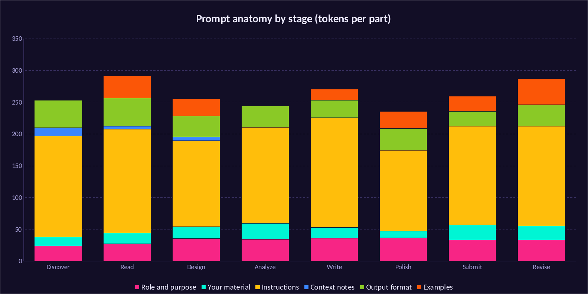
</p>

On average, **58% of a strong prompt is instructions**, 13% is the output format, 12% is the role and purpose, 8% is examples and 7% is the tags around your material. The role line is short, but it carries the *why* ("a PhD student will rely on your summary instead of re-reading the paper"), which the guidance says changes how the model makes trade-offs.

### Longer is not the goal

<p align="center">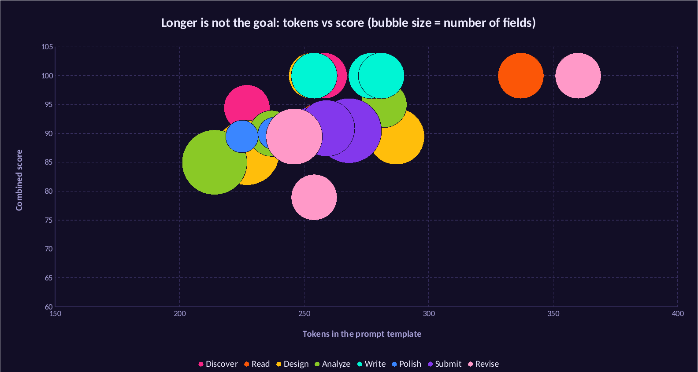</p>

The strong prompts range from 214 to 360 tokens, and their scores do not rise with length. The two longest (the Paper deconstructor and the Response to reviewers) score 100, but so do the Experiment planner and the Related work synthesizer at about 250 tokens, while the Rebuttal tone fixer scores 79 at the same length. What moves the score is *which* instructions are present, such as "use only the paper", "quote" and "write Not reported", not how many words surround them.

---

## 💸 Running them cheaply

A strong prompt adds about 262 tokens. Next to a 12,000-token paper that is **2.2% of the input**, so quality is almost free:

<p align="center">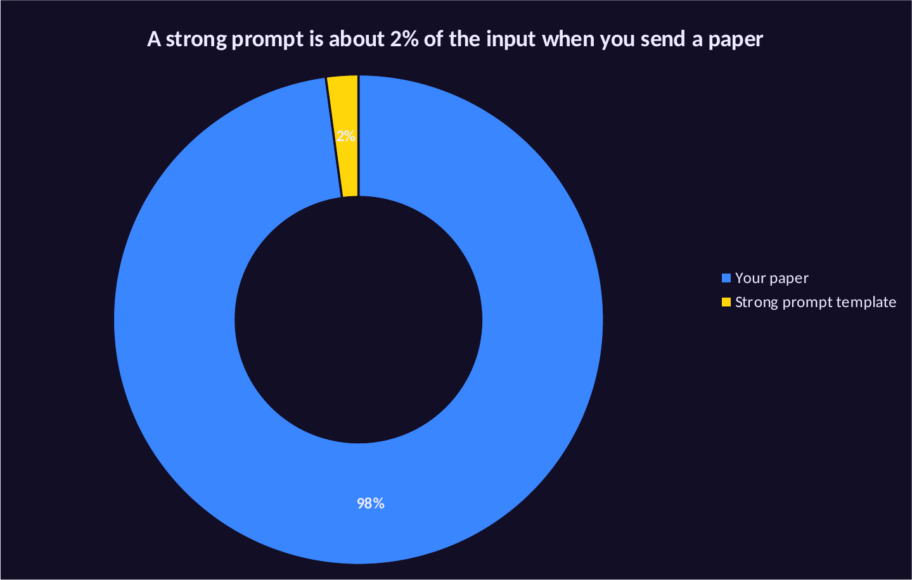</p>

The real money is the paper itself, sent again with every question. That is where **prompt caching** helps, and where the order of the prompt matters.

<p align="center">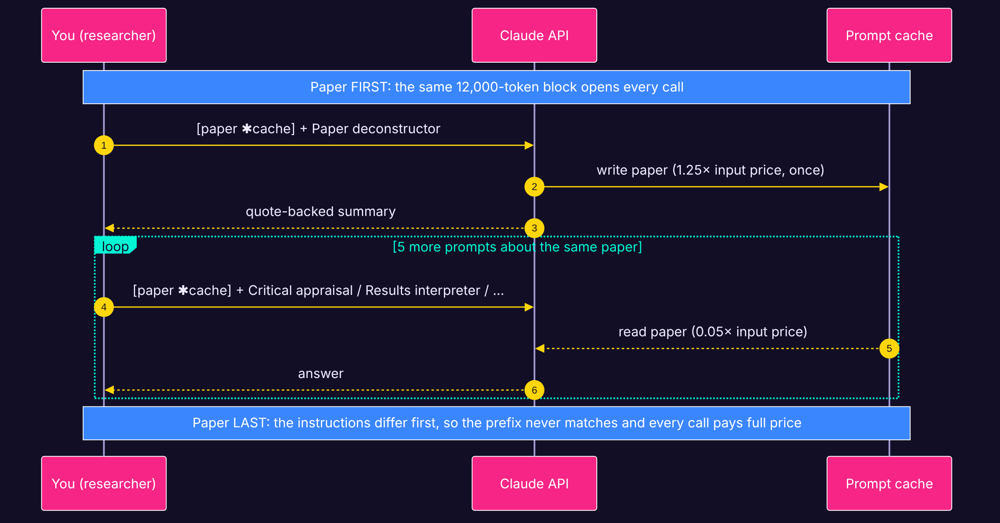</p>

Caching works on an identical **prefix**. If the paper sits after instructions that change from prompt to prompt, the prefix never matches and every call pays full price. If the paper comes first, in the same block every time, call 1 writes it to the cache and calls 2, 3, 4 ... read it for a small fraction of the input price. The CLI's `--cache-layout` and `Prompt.cache_layout()` move the paper block to the front for you.

**The equations.** For $k$ prompts about one paper of $P$ tokens, a prompt of $T$ tokens and answers of $O$ tokens:

$$C_\text{paper last} = k\,\big[(P+T)\,p_\text{in} + O\,p_\text{out}\big]$$

$$C_\text{paper first} = P\,p_\text{write} + (k-1)\,P\,p_\text{read} + k\,\big[T\,p_\text{in} + O\,p_\text{out}\big]$$

With Claude Sonnet 5.5 prices (input 2.00, cache write 2.50, cache read 0.10 and output 10.00 USD per million tokens), $P$ = 12,000, $T$ = 268 (the measured average of the read and analyze prompts) and $O$ = 1,000:

* The cache write costs **\$0.006 extra on the first call**, and pays for itself on the **second** call.
* Each further call costs **\$0.0117 instead of \$0.0345**, a saving that approaches **66%** as $k$ grows.
* The Batch API halves every price again, for work that can wait up to 24 hours.

<p align="center">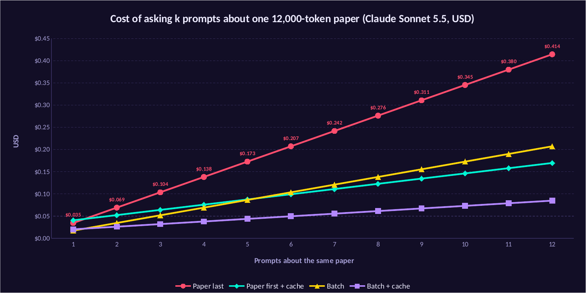</p>

**A whole literature review**: 40 papers, 6 prompts each (deconstruct, appraise, compare, interpret, critique the figures, check the code):

| Model | Paper last | Paper first + cache | Batch | Batch + cache |
|---|:---:|:---:|:---:|:---:|
| Claude Sonnet 5.5 | \$8.29 | \$3.97 | \$4.14 | **\$1.98** |
| Claude Opus 5.5 | \$16.58 | \$7.94 | \$8.29 | **\$3.97** |
| Claude Haiku 5.5 | \$0.41 | \$0.21 | \$0.21 | **\$0.11** |

<p align="center">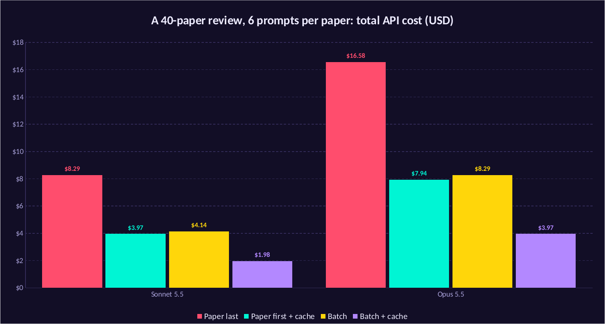</p>

With Sonnet 5.5, the same review drops from **\$8.29 to \$3.97** just by putting the paper first, and to **\$1.98** through the Batch API. The live model is in the **Cost Model** sheet of the workbook: change the paper size, the number of papers or the model, and every number and chart updates.

> Prices: [platform.claude.com/docs/en/about-claude/pricing](https://platform.claude.com/docs/en/about-claude/pricing), retrieved 2026-11-09. The 5-minute cache expires if you pause longer between prompts; the 1-hour cache costs 2× input to write. Inside the Batch API, cache hits are best effort. The paper size, the answer length and the number of prompts are assumptions; put in your own.

---

## 🧠 How to work with Claude as a researcher

These habits matter more than any single prompt.

1. **Paper first, question last.** Long documents at the top, instructions and the question at the bottom. Better answers, and it makes caching possible.
2. **Ask for quotes, then for the answer.** "First copy the sentences that matter, then answer using only them." This is the single most effective way to keep answers grounded.
3. **Give an exit.** "If it is not in the paper, write Not reported." Without it, a helpful model will try to help by guessing.
4. **One job per prompt.** Summarize in one prompt, appraise in another, compare in a third. Chain the outputs instead of asking for everything at once.
5. **Say who it is for and why.** "My supervisor will check this for gaps" produces a different, more careful answer than no context at all.
6. **Fix the output format.** Tables with named columns are easy to check, paste into your notes, and compare across papers.
7. **Keep your citations your own.** Let Claude cite only from the list you gave it. Check every reference yourself before it enters a manuscript.
8. **Keep your voice.** For editing, say "keep my claims, numbers and terms; change wording only", and ask for a table of changes so you can accept or reject each one.
9. **Use Claude as a reviewer, not only as a writer.** The Reviewer 2 simulator and the results interpreter often save more time than any drafting prompt, because they find problems while they are still cheap to fix.
10. **Follow your field's rules on AI use.** Many journals ask authors to disclose AI assistance, and you remain responsible for every word and number. These prompts are built to keep you in control of both.

---

## 🗂️ Repository layout

```text
claude-research-prompts/
├── prompts/                      the 24 prompts, one file each, in 8 stage folders
│   ├── 01-discover/  02-read/  03-design/  04-analyze/
│   └── 05-write/     06-polish/  07-submit/  08-revise/
├── researchprompts/              the Python package
│   ├── library.py                load, fill, cache_layout
│   ├── lint.py                   the 11 general checks
│   ├── research_lint.py          the 6 research checks and the scores
│   ├── anatomy.py                tokens per part of a prompt
│   ├── cost.py                   API cost with and without caching
│   ├── tokens.py                 token counts (open Llama 4 tokenizer as a stand-in)
│   └── __main__.py               the command-line tool
├── examples/                     a sample paper, a filled prompt, an API script
├── run_analysis.py               scores, anatomy and cost -> results/analysis.json
├── build_excel.py                the workbook with live formulas and native charts
├── render_excel_charts.py        exports the Excel charts to PNG (LibreOffice)
├── make_visuals.py               banner, stage cards, before/after card
├── diagrams/                     Mermaid sources for the three diagrams
├── excel/claude_research_prompts.xlsx
├── results/                      every image in this README, plus analysis.json
└── tests/test_prompts.py         30 tests
```

## 🔁 Reproduce everything

```bash
pip install -r requirements.txt
python run_analysis.py           # scores, anatomy, costs -> results/analysis.json
python build_excel.py            # -> excel/claude_research_prompts.xlsx
python render_excel_charts.py    # Excel charts -> results/*.png (needs LibreOffice)
python make_visuals.py           # banner and cards
for f in diagrams/*.mmd; do mmdc -i $f -o results/$(basename $f .mmd).png -b "#120E26" -s 2 -w 1800; done
python -m pytest -q
```

Add your own prompt by dropping a file into the right stage folder with the same header (`id`, `title`, `stage`, `kind`, `use`, `weak`). It appears in `list`, gets scored, and shows up in every chart on the next run.

---

## ❓ FAQ

**Do these prompts work with other models?**
Yes. They are plain text, and the habits behind them (ground the answer, ask for quotes, allow "not reported") help any model. The checks and the cost math are written for Claude.

**Does a score of 100 mean the answer will be correct?**
No. The score shows what the prompt *asks for*. Whether the model follows it depends on the model and the task. Always test a prompt on two or three papers you know well before you rely on it.

**Why does the linter count tokens with the Llama 4 tokenizer?**
Claude's tokenizer is not public. The open Llama 4 tokenizer gives counts in the same range for English text. For exact numbers use the `count_tokens` endpoint of the Claude API.

**Can I use these to write my paper for me?**
They are built to help you write *your* paper: they use only your facts, your citations and your voice, and they mark what is missing instead of inventing it. Check your journal's policy on AI assistance and disclose it where required.

**The paper is longer than 12,000 tokens. Does the cost math change?**
The pattern holds and the saving grows, because the cached part is a bigger share of each call. Change "Tokens in one paper" in the Cost Model sheet.

**Why are some strong prompts below 100?**
Because the checker is honest. Some checks fit a task poorly (a tone rewrite has little use for quotes), and a few prompts genuinely could say more, such as "why" for the methodology designer. The details under each prompt list what it misses.

---

## ⚠️ Limits

* The linter matches patterns in the text. It cannot judge whether an instruction is *wise*, only whether it is there.
* The research checks are my selection, based on Anthropic's hallucination guide and review practice. Other researchers may weigh them differently; the weights are editable.
* No prompt removes the need to read the paper. These prompts make Claude's answers checkable; checking them is still your job.
* Costs use list prices on the date shown and assumed sizes. Real bills depend on your papers, your answers and cache hit rates.

## 📎 Sources

* Anthropic, *Prompting best practices*: [platform.claude.com/docs/en/build-with-claude/prompt-engineering/claude-prompting-best-practices](https://platform.claude.com/docs/en/build-with-claude/prompt-engineering/claude-prompting-best-practices)
* Anthropic, *Reduce hallucinations*: [platform.claude.com/docs/en/test-and-evaluate/strengthen-guardrails/reduce-hallucinations](https://platform.claude.com/docs/en/test-and-evaluate/strengthen-guardrails/reduce-hallucinations)
* Anthropic, *Pricing* and *Prompt caching*: [platform.claude.com/docs/en/about-claude/pricing](https://platform.claude.com/docs/en/about-claude/pricing), [platform.claude.com/docs/en/build-with-claude/prompt-caching](https://platform.claude.com/docs/en/build-with-claude/prompt-caching)
* J. M. Swales, *Genre Analysis: English in Academic and Research Settings*, Cambridge University Press, 1990 (the CARS model).
* S. R. Cummings et al., *Designing Clinical Research* (the FINER criteria for research questions).

## 👤 Author

**Eng. Jaafar Salim**, University of Technology, Iraq. More projects: [github.com/jafarSalim](https://github.com/jafarSalim)

If this saved you an evening of prompt writing, a ⭐ helps other researchers find it.

## 📄 License

MIT. See [LICENSE](LICENSE).
